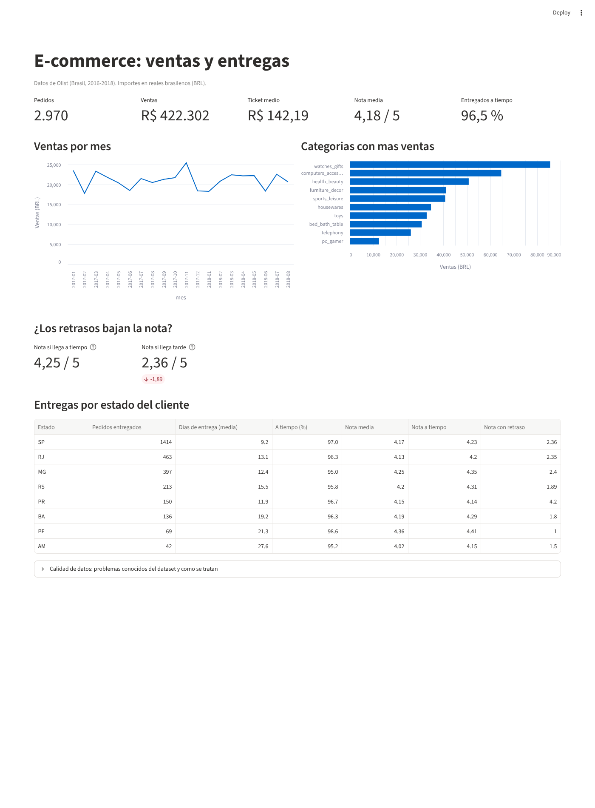
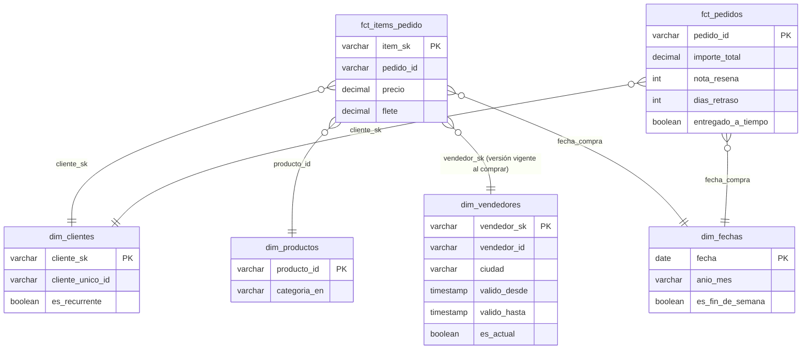

# Data warehouse de e-commerce con dbt y DuckDB

Data warehouse en **modelo estrella** sobre ~100.000 pedidos reales del e-commerce brasileño
**Olist**, construido con **dbt** sobre **DuckDB** y con un dashboard en **Streamlit**. Responde a
una pregunta de negocio: *¿cuánto baja la nota de un cliente cuando su pedido llega tarde?*


**Stack:** dbt 1.11 · DuckDB · Streamlit · Python · GitHub Actions · GitHub Pages.
Todo es gratuito y funciona en local, sin servidores ni cuentas en la nube.


*Captura con la muestra sintética del repositorio; con los datos reales las cifras cambian.*

## Modelo de datos



| Capa | Esquema | Modelos | Qué hace |
|---|---|---|---|
| Fuentes | — | 8 CSV de Olist | DuckDB los lee directamente, sin un paso de carga |
| Staging | `staging` | `stg_olist__*` (8) | Tipos, nombres en español y limpieza de los problemas de calidad |
| Snapshot | `snapshots` | `snap_vendedores` | Histórico de vendedores (SCD tipo 2) |
| Intermediate | `intermediate` | `int_pedidos__*` (2) | Totales por pedido de líneas y pagos |
| Core | `core` | 4 dimensiones + 2 tablas de hechos | El modelo en estrella |
| Informes | `informes` | `mart_ventas_mensuales`, `mart_entregas_por_estado` | Tablas listas para el dashboard |

## Problemas de calidad del dataset y cómo se tratan

El dataset real tiene problemas conocidos. Cada uno se resuelve en un modelo concreto, y la
muestra sintética los reproduce para que los tests los cubran.

| Problema | Dónde se resuelve |
|---|---|
| `customer_id` cambia en cada pedido: el cliente real es `customer_unique_id` | `dim_clientes` (una fila por cliente real) |
| Un pedido puede tener varias reseñas, y un `review_id` aparecer en varios pedidos | `stg_olist__resenas` (la más reciente por pedido) |
| Pedidos *delivered* sin fecha de entrega | `fct_pedidos` (no cuentan como entregados) |
| Productos sin categoría y categorías sin traducción al inglés | `dim_productos` |
| Códigos postales que pierden el cero inicial (`1037`) | `stg_olist__clientes`, `stg_olist__vendedores` |
| Columnas con erratas (`product_name_lenght`) | `stg_olist__productos` |
| Pagos repartidos en varias líneas (voucher + tarjeta) | `int_pedidos__pagos_agregados` |

## Decisiones de diseño

- **Dos tablas de hechos con granularidad distinta.** `fct_items_pedido` (una línea de pedido)
  para analizar productos y vendedores; `fct_pedidos` (un pedido) para pagos, reseñas y
  entregas. Mezclarlas obligaría a repetir el pago o la nota en cada línea.
- **SCD tipo 2 con un snapshot de dbt.** Si un vendedor cambia de sede, se guarda una versión
  nueva en vez de sobrescribir la antigua. Los hechos se unen a la versión **vigente en la fecha
  de la compra**, así que las ventas antiguas no se mueven de ciudad.
- **La primera versión vale "desde siempre".** El snapshot fecha cada versión cuando detecta el
  cambio (hoy), pero los pedidos son de 2016-2018. Sin este ajuste, ningún pedido encontraría su
  vendedor. Hay un unit test para este caso y un test que comprueba que las versiones no se
  solapan (si se solaparan, se duplicarían las ventas).
- **Todo se lee como texto y se tipa a mano en staging.** Así un CSV con un valor raro no cambia el
  tipo de una columna sin que nadie se entere.
- **Staging como tablas, no como vistas.** Una vista sobre `read_csv()` guarda la ruta relativa
  de los CSV y falla si se consulta desde otra carpeta. Como tablas, el fichero
  `warehouse.duckdb` queda autocontenido y el dashboard funciona desde cualquier sitio.
- **Contrato en `fct_pedidos`.** dbt comprueba los nombres y tipos de sus columnas antes de
  construirla: si un cambio rompe lo que espera el dashboard, falla el build y no el dashboard.
- **Tres niveles de tests:** 54 tests de datos (unicidad, nulos, relaciones entre hechos y
  dimensiones, valores aceptados), 2 *unit tests* de dbt sobre la lógica de entregas y del SCD2,
  y 15 tests de Python para los scripts y las consultas del dashboard.
- **Linaje hasta el dashboard.** Una *exposure* declara qué modelos usa el dashboard y aparece en el
  grafo de la documentación.

## Puesta en marcha

Requisitos: Python 3.11 o superior. Comandos en PowerShell, desde la carpeta del proyecto.

```bash
python -m venv .venv
```
```bash
.venv\Scripts\Activate.ps1
```
```bash
pip install -r requirements-dev.txt
```

### Opción A: con la muestra sintética (1 minuto)

```bash
python scripts/generar_muestra.py
```
```bash
$env:OLIST_DIR = "../data/muestra"
```
```bash
cd dbt
```
```bash
dbt build --profiles-dir .
```

### Opción B: con los datos reales de Olist

1. Descarga el dataset de Kaggle (necesitas una cuenta gratuita):
   [Brazilian E-Commerce Public Dataset by Olist](https://www.kaggle.com/datasets/olistbr/brazilian-ecommerce).
2. Descomprime los CSV en `data/olist/`. El de geolocalización no se usa.

3. Ejecuta dbt. Por defecto lee de `data/olist/`:
```bash
cd dbt
```
```bash
dbt build --profiles-dir .
```

Con los datos reales es normal un aviso (`WARN`) en `assert_pagos_cuadran_con_importe`: en
algunos pedidos el pago no coincide con productos + flete por redondeos y vouchers.

### El dashboard

Desde la carpeta del proyecto (no desde `dbt/`):
```bash
streamlit run app/dashboard.py
```
Se abre en http://localhost:8501. Cierra el dashboard antes de volver a ejecutar dbt: DuckDB no
deja escribir en el fichero mientras otro programa lo tiene abierto.

### Ver el SCD tipo 2 en acción

```bash
python scripts/simular_cambios.py --dir data/muestra --porcentaje 10
```
```bash
cd dbt
```
```bash
dbt snapshot --profiles-dir .
```
```bash
dbt build --profiles-dir . --exclude resource_type:snapshot
```
Consulta `core.dim_vendedores`: los vendedores que se han mudado tienen ahora dos filas, y sus
ventas antiguas siguen en la versión antigua. Para deshacer el cambio en el CSV:
`python scripts/simular_cambios.py --dir data/muestra --restaurar`.

### Documentación de dbt

```bash
dbt docs generate --profiles-dir .
```
```bash
dbt docs serve --profiles-dir . --port 8081
```
La CI la publica en GitHub Pages en cada push a `main`. Para activarlo una vez:
*Settings → Pages → Source: GitHub Actions*.

## Tests

```bash
pytest -v
```
Los tests de las consultas del dashboard necesitan haber ejecutado antes `dbt build`; si no, se
omiten. La CI hace en cada push: lint, la muestra, `dbt build`, la demostración del SCD2, pytest
y la documentación.

## Estructura

```
├── dbt/
│   ├── models/staging/        Limpieza y tipos (una tabla por CSV)
│   ├── models/intermediate/   Agregados por pedido
│   ├── models/marts/core/     Modelo estrella + unit tests
│   ├── models/marts/informes/ Tablas del dashboard + exposure
│   ├── snapshots/             SCD tipo 2 de vendedores
│   ├── tests/                 Tests singulares
│   └── macros/                clave_surrogada, generate_schema_name
├── app/                       Dashboard (Streamlit) y sus consultas
├── scripts/                   Muestra sintética y simulación de cambios
└── tests/                     pytest
```


Datos: [Olist](https://www.kaggle.com/datasets/olistbr/brazilian-ecommerce), licencia
CC BY-NC-SA 4.0. No se incluyen en el repositorio.
